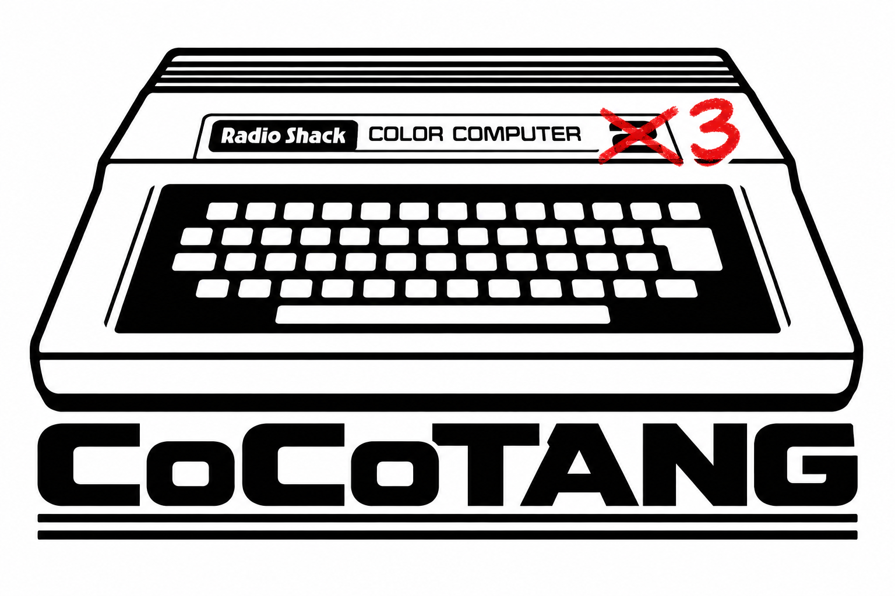
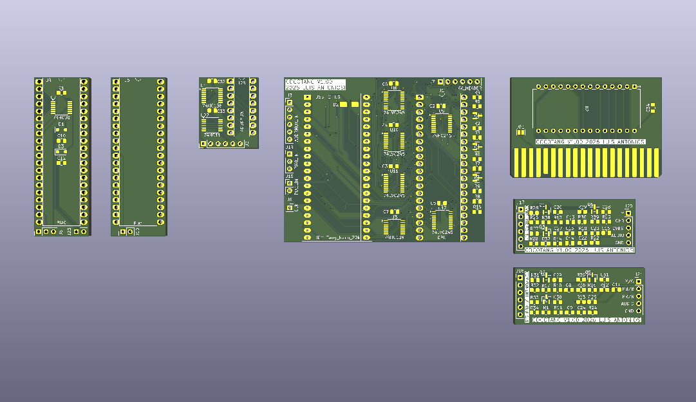

# CoCoTANG



# WARNING: WIP Project - DO NOT ISSUE BOARDS YET

Until we greenlit the project, do not order boards yet, but you are free to sneak peek the project so far.

## Current rollout: 

- A new board has been designed but not issued
- Still deciding on PIAs layout

# Project Description

CoCoTANG is a Tang Nano 20K-based CoCo 3 upgrade for the Radio Shack/Tandy Color Computer. It keeps the original MC6809E CPU and motherboard PIAs while the FPGA implements the GIME video and memory subsystem, HDMI and analog video output, and an SD-card-backed Glenside-compatible IDE interface. The FPGA sources, KiCad board files, manufacturing files, and bill of materials are in this repository.



The PCB is manufactured as one panel containing eight sections: the **main board**; **PIA0**, **PIA1**, **CPU**, and **74LS138 displacers**; a **Component/RGB video hat**; a **CVBS/S-Video hat**; and an **HDBDOS ROM cartridge**. The render shows their arrangement before the sections are separated for assembly.

The design uses NTSC-machine clocking. The GIME's 50 Hz setting remains available, but it does **not** switch to a PAL crystal or PAL color encoding. See the [FPGA design notes](fpga/README.md) for supported video modes and hardware details.

## Hardware and files

| Item | File or notes |
| --- | --- |
| PCB fabrication files | [KiCad Gerber/drill ZIP](kicad/gerber.zip) |
| KiCad schematic and PCB | [kicad/](kicad/) |
| Components | Full bill of materials below |
| FPGA project and sources | [fpga/](fpga/) |
| FPGA pin/bus map | [fpga/docs/pinout.md](fpga/docs/pinout.md) |

## Bill of materials

| Qty | Value | Description | DigiKey P/N | References | Alternative link |
| ---: | --- | --- | --- | --- | --- |
| 16 | 0.1uF | CAP CER 0805 0.1UF 100VDC X7R | [399-C0805F104K1RACAUTOCT-ND](https://www.digikey.com/en/products/detail/kemet/C0805F104K1RACAUTO/26735352) | C1,C2,C3,C4,C5,C6,C7,C26,C27,C28,C29,C30,C31,C32,C33,C34 | |
| 6 | 470pF | CAP CER 470PF 50V C0G/NP0 0805 | [490-1617-1-ND](https://www.digikey.com/en/products/detail/murata-electronics/GRM2165C1H471JA01D/587515) | C8,C9,C11,C13,C14,C16 | |
| 1 | 1uF | CAP CER 1UF 25V X7R 0805 | [399-C0805C105K3RACTUCT-ND](https://www.digikey.com/en/products/detail/kemet/C0805C105K3RACTU/3471727) | C15 | |
| 2 | 6.8nF | CAP CER 6800PF 250V C0G/NP0 0805 | [490-GCM21B5C2E682JX0ALCT-ND](https://www.digikey.com/en/products/detail/murata-electronics/GCM21B5C2E682JX0AL/17846799) | C22,C24 | |
| 2 | 4.7uF | CAP CER 4.7UF 16V X7R 0805 | [732-7666-1-ND](https://www.digikey.com/en/products/detail/w%C3%BCrth-elektronik/885012207053/5453521) | C23,C25 | |
| 2 | SD103BW | DIODE SCHOTTKY 30V 0.35A SOD123F | [4878-SD103BWCT-ND](https://www.digikey.com/en/products/detail/diotec-semiconductor/SD103BW/22600375) | D1,D3 | |
| 1 | SS14 | DIODE SCHOTTKY 40V 1A DO214AC | [SS14CT-ND](https://www.digikey.com/en/products/detail/onsemi/SS14/965474) | D2 | |
| 14 | 1K | RES 1K OHM 1% 1/8W 0805 | [541-3977-1-ND](https://www.digikey.com/en/products/detail/vishay-dale/CRCW08051K00FKEAC/7928660) | R1,R16,R17,R18,R23,R25,R27,R29,R31,R33,R35,R37,R38,R39 | |
| 3 | 10K | RES 10K OHM 1% 1/8W 0805 | [311-10.0KCRCT-ND](https://www.digikey.com/en/products/detail/yageo/RC0805FR-0710KL/727535) | R2,R4,R6 | |
| 9 | 4.7K | RES 4.7K OHM 1% 1/8W 0805 | [311-4.70KCRCT-ND](https://www.digikey.com/en/products/detail/yageo/RC0805FR-074K7L/730876) | R3,R5,R7,R26,R28,R30,R32,R34,R36 | |
| 2 | 47K | RES SMD 47K OHM 1% 1/8W 0805 | [YAG3735CT-ND](https://www.digikey.com/en/products/detail/yageo/AC0805FR-0747KL/6006584) | R8,R9 | |
| 6 | 75 | RES 75 OHM 1% 1/8W 0805 | [541-CRCW080575R0FKEACCT-ND](https://www.digikey.com/en/products/detail/vishay-dale/CRCW080575R0FKEAC/12745060) | R10,R11,R12,R13,R14,R15 | |
| 2 | 100K | RES 100K OHM 1% 1/8W 0805 | [541-3978-1-ND](https://www.digikey.com/en/products/detail/vishay-dale/CRCW0805100KFKEAC/7928661) | R22,R24 | |
| 9 | MMBT3904-TP | TRANS NPN 40V 0.2A SOT-23 | [MMBT3904TPMSCT-ND](https://www.digikey.com/en/products/detail/mcc-micro-commercial-components/MMBT3904-TP/717280) | Q1,Q2,Q3,Q4,Q5,Q6,Q7,Q8,Q9 | |
| 1 | SN74HC138PWR | IC DECODER/DEMUX 1X3:8 16-TSSOP | [296-8228-1-ND](https://www.digikey.com/en/products/detail/texas-instruments/SN74HC138PWR/377034) | U1 | |
| 1 | 74HC139 | IC DECODER/DEMUX 1X2:4 16-TSSOP | [1727-6580-1-ND](https://www.digikey.com/en/products/detail/nexperia-usa-inc/74HC139PW-118/2813773) | U3 | |
| 1 | Tang Nano 20K | Tang Nano 20K FPGA Board | N/A | U5 | [AliExpress](https://www.aliexpress.com/item/1005010280135538.html) |
| 1 | 74HC30 | IC NAND 1-CIR 8-IN 14-TSSOP | [1727-6596-1-ND](https://www.digikey.com/en/products/detail/nexperia-usa-inc/74HC30PW-118/1230294) | U7 | |
| 4 | SN74LVC245AN | IC TXRX 1.65V/3.6V 20-TSSOP | [296-1233-1-ND](https://www.digikey.com/en/products/detail/texas-instruments/SN74LVC245APWR/276501) | U8,U10,U11,U12 | |
| 1 | SN74HC245PWR | IC TXRX 2V/6V 20-TSSOP | [296-8279-1-ND](https://www.digikey.com/en/products/detail/texas-instruments/SN74HC245PWR/376997) | U9 | |
| 1 | 74HC11 | IC AND 3-CIR 3-IN 14-TSSOP | [296-13611-1-ND](https://www.digikey.com/en/products/detail/texas-instruments/SN74HC11PWR/498520) | U22 | |
| 1 | DIP-16 SOCKET | CONN IC DIP SOCKET 16POS GOLD | [SA163000](https://www.digikey.com/en/products/detail/on-shore-technology-inc/SA163000/3313525) | 74LS138 | |
| 3 | DIP-40 SOCKET | MACHINE PIN SOCKET, IC, DIP, 40P | [ICM-640-1-GT-HT](https://www.digikey.com/en/products/detail/adam-tech/ICM-640-1-GT-HT/9832971) | J1,J4,J5,PIA0,PIA1,CPU | [AliExpress](https://www.aliexpress.com/item/1005006139495909.html) |
| 1 | SIL FEMALE HDR | MACHINE PIN SOCKET 40P 2.54MM PI | [SMC-1A-40-1-GT-HT](https://www.digikey.com/en/products/detail/adam-tech/SMC-1A-40-1-GT-HT/9831942) | U5 | [AliExpress](https://www.aliexpress.com/item/1005008648234734.html) |
| 8 | SIL HEADER | CONN SIL HDR MALE PIN 20POS | [D01-9922046](https://www.digikey.com/en/products/detail/harwin-inc/D01-9922046/3727867) | J9,12,J13,U5 | [AliExpress](https://www.aliexpress.com/item/1005007563971977.html) |
| 2 | SIL MALE HEADER | CONN HDR .100" 8POS | [TS-108-T-A-1](https://www.digikey.com/en/products/detail/samtec-inc/TS-108-T-A-1/9772928) | J28 | [AliExpress](https://www.aliexpress.com/item/1005007563971977.html) |
| 1 | AT28C64B-15PU | IC EEPROM 64KBIT PARALLEL 28DIP | [AT28C64B-15PU-ND](https://www.digikey.com/en/products/detail/microchip-technology/AT28C64B-15PU/1008529) | U2 | |
| 1 | DIP-28 SOCKET | CONN IC DIP SOCKET 28POS GOLD | [110-41-628-41-001000](https://www.digikey.com/en/products/detail/mill-max-manufacturing-corp/110-41-628-41-001000/2538108) | U2 | |
| 1 | 5-PIN DIN | RECEPTACLE - DIN 5 PIN FEMALE - | [NYS325](https://www.digikey.com/en/products/detail/neutrik-americas-inc/NYS325/29713928) | | |
| 1 | JUMPER CABLES FEMALE HDR | SET OF MALE-FEMALE CABLES, 40 PI | [555035](https://www.digikey.com/en/products/detail/soldered-electronics/555035/29288637) | | |
| 1 | HEADER PINS RIGHT ANGLE | CONN HEADER R/A 40POS | [PEC36SBAN](https://www.digikey.com/en/products/detail/sullins-connector-solutions/PEC36SBAN/860089) | | [AliExpress](https://www.aliexpress.com/item/1005006181766297.html) |

**Check the BOM and the KiCad design together before ordering:** some rows are assembly accessories rather than PCB placements, and connector orientation and socket fit matter. Quantities, references, and part numbers above follow the supplied BOM as written.

**Sourcing tip:** Most listed parts can be sourced through DigiKey; the Sipeed Tang Nano 20K is the notable exception. Compare prices before ordering the mechanical parts in particular: DIP sockets and FFC cables can be relatively expensive at DigiKey. The alternative links in the table point to AliExpress listings for some of these items, but other suppliers may be cheaper too. When substituting, verify pin count, pitch, cable length and contact orientation, and socket dimensions against the KiCad design—not just the product title.

## Build on macOS or Linux

1. Download **GOWIN EDA Education** for your OS from [Gowin's official download page](https://www.gowinsemi.com/en/support/download_eda/) (an account may be required). Install the full EDA package, not only Gowin Programmer. The Education edition is intended for noncommercial education/research; check Gowin's current terms for your use.
2. Install [openFPGALoader](https://trabucayre.github.io/openFPGALoader/guide/install.html) and, for simulation, Icarus Verilog (`iverilog` and `vvp`). On macOS, `brew install openfpgaloader icarus-verilog` is one option. On Debian/Ubuntu, `sudo apt install openfpgaloader iverilog` is one option. Linux may also need the [openFPGALoader udev rules](https://trabucayre.github.io/openFPGALoader/guide/install.html) for non-root USB access.
3. From the FPGA directory, build and check the routed design:

   ```sh
   cd fpga
   make test
   make rebuild
   make timing
   ```

   `make test` is optional for building the bitstream. Its current recipes write simulation executables to `/private/tmp`, so on Linux that directory must exist and be writable if you run the tests; `make rebuild` and `make timing` do not need it.

The output is [`fpga/impl/pnr/CoCoTANG.fs`](fpga/impl/pnr/CoCoTANG.fs). `make rebuild` always runs synthesis and place-and-route; `make build` rebuilds only when Make considers an input newer than the bitstream. The Makefile expects Gowin at `/Applications/GowinIDE.app/Contents/Resources/Gowin_EDA/IDE` on macOS or `/opt/Gowin/IDE` on Linux. If yours is elsewhere, pass `GOWIN_IDE=/path/to/Gowin_EDA/IDE` to Make.

## Program on macOS or Linux

Connect the Tang Nano 20K by USB. The FPGA configuration and CoCo 3 ROM are **two separate writes** to the module's external SPI flash:

| Flash address | Contents | Command from `fpga/` |
| --- | --- | --- |
| `0x000000` | FPGA configuration (`impl/pnr/CoCoTANG.fs`) | `make program` or `make reprogram` |
| `0x100000` (1,048,576 decimal) | 32 KiB CoCo 3 ROM (`roms/coco3.rom`) | `make rom` |

```sh
cd fpga
make program     # builds if needed, then writes persistent FPGA configuration
make rom         # writes the ROM at 0x100000; needed for first setup
```

`make reprogram` flashes the existing bitstream without rebuilding. These Make targets use [openFPGALoader's `tangnano20k` board support](https://trabucayre.github.io/openFPGALoader/vendors/gowin.html). The ROM offset is set by `ROM_OFFSET=1048576` in the Makefile and by the FPGA flash loader; **do not write the ROM at address zero**, or it will overwrite the FPGA configuration. After both writes, power-cycle the board. The FPGA holds the CPU until its clocks, SDRAM, and ROM load are ready.

## Windows: Gowin Programmer

For Windows, use the [Gowin Programmer](https://www.gowinsemi.com/en/support/download_eda/) supplied with Gowin EDA Education (or Gowin's standalone Programmer). The repository's Makefile is written for macOS/Linux and uses `openFPGALoader`; it is not a native Windows programming recipe. Gowin's [Programmer User Guide](https://www.gowinsemi.com/en/document/main/database/14/) describes the device-configuration dialog.

1. Install Gowin's USB programmer driver, connect the Tang Nano 20K, and open **Gowin Programmer**. Scan the cable/device; the board uses a GW2AR-18C in a QN88 package.
2. To test without preserving the configuration after power-off, choose **SRAM Mode → SRAM Program** and select `fpga/impl/pnr/CoCoTANG.fs`.
3. To make the FPGA configuration persistent, open **Edit → Configure Device**, choose **External Flash Mode**, select **exFlash Erase, Program thru GAO-Bridge** (or its verify variant), choose `fpga/impl/pnr/CoCoTANG.fs`, set **External Flash Options → Start Address** to `0x000000`, save, then click **Program/Configure**.
4. Program the ROM as a **separate raw binary** operation: configure **External Flash Mode**, choose **exFlash C Bin Erase, Program thru GAO-Bridge** (or its verify variant), select `fpga/roms/coco3.rom` under **FW/MCU/Binary Input Options → Firmware/Binary File**, choose **Generic Flash** if a flash-device choice is required, and set **External Flash Options → Start Address** to **`0x100000`**. Save and program. The dialog wording varies between Gowin releases; the important distinction is the raw-binary operation and the 1 MiB start address.
5. Power-cycle the board. If the FPGA configures but the CPU does not start, recheck the ROM write and its offset.

**Windows USB driver choice:** Gowin Programmer and openFPGALoader may require different USB drivers. The normal Windows path above uses Gowin's driver. If you choose to use openFPGALoader on Windows instead, install its Windows build and use [Zadig](https://zadig.akeo.ie/) to bind **WinUSB** to the Tang Nano 20K's *programming/JTAG interface* (enable **Options → List All Devices** if necessary). Check the device/interface identity before clicking **Install/Replace Driver**—do not replace an unrelated USB interface. Switching to WinUSB can stop Gowin Programmer from seeing the board; restore the Gowin driver in Device Manager or reinstall it when returning to Gowin Programmer. [libusb's Windows guidance](https://github.com/libusb/libusb/wiki/Windows) recommends WinUSB for libusb applications.

## Project status

This is an actively developed hardware/RTL project. Review the [FPGA notes](fpga/README.md), [pinout](fpga/docs/pinout.md), and KiCad files before building hardware. Flashing a new FPGA image or ROM changes the board's nonvolatile contents; keep a known-good image available while experimenting.
