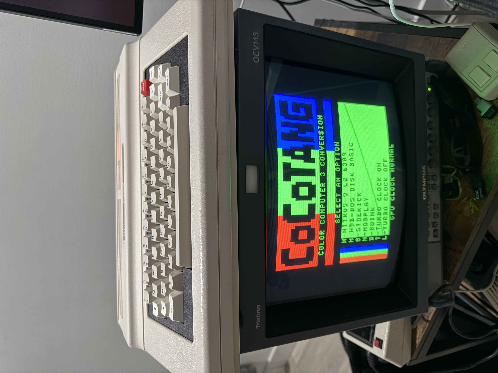
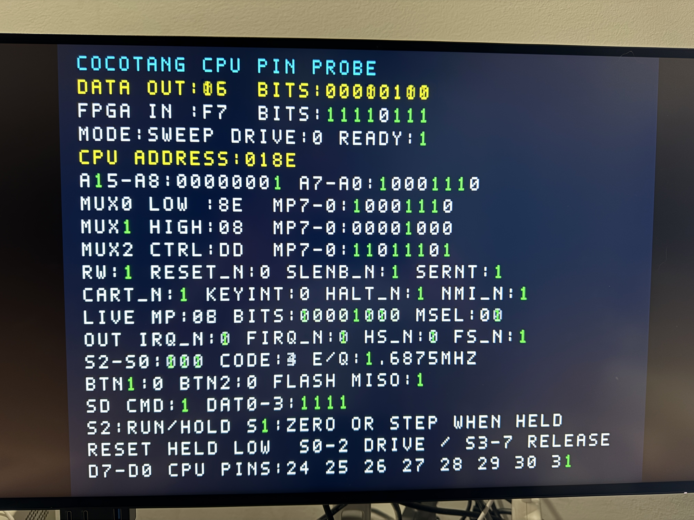

# CoCoTANG


## Overview

CoCoTANG upgrades the Radio Shack/Tandy Color Computer with a Tang Nano 20K FPGA board and CoCo 3 video and memory features. It retains the MC6809E CPU and motherboard PIAs while the FPGA implements the GIME video and memory subsystem, HDMI and analog video outputs, and a Glenside-compatible IDE interface backed by a microSD card. It also provides 8 MB of RAM, Orchestra-90 audio with stereo over HDMI, and Tandy Speech/Sound Cartridge (SSC) support.

This repository contains the FPGA sources, KiCad designs, fabrication files, and bill of materials.


The assembly uses a **main board** for the CPU and Tang Nano 20K, **PIA0 and PIA1 adapter boards**, and an **address mux board** that replaces the motherboard 74LS138. An **analog video hat** and an **HDB-DOS ROM cartridge** are optional. The render above shows the boards arranged as a PCB panel. HDB-DOS can also be supplied through an FD-502 ROM socket or CoCo SDC flash bank.

The design uses NTSC machine clocking. The GIME's 50 Hz setting remains available, but selecting it does **not** switch to a PAL crystal. PAL-encoded CVBS/S-Video output is also supported. See [Build on macOS or Linux](#build-on-macos-or-linux) for video targets and the [FPGA pin and bus map](fpga/docs/pinout.md) for hardware connections.

## Current FPGA features

- GIME video and memory mapping with 8 MB NoCan3-style RAM support and readable Disto MMU page bits.
- Simultaneous HDMI and analog video, with separate RGB, YPbPr, and CVBS/S-Video build targets.
- Six motherboard RESET selections combining normal, reversed, or disabled artifact colours with SSC sound/speech off or on.
- Tandy Speech/Sound Cartridge PSG, buffered allophones, and ASCII English text-to-speech, alongside the CoCo DAC and Orchestra-90 audio.
- HDMI status labels and an optional analog status banner with a larger font.

## Hardware and files

| Item | File or notes |
| --- | --- |
| PCB fabrication files | [Gerber/drill ZIPs for each board](kicad/gerber/) |
| KiCad schematic and PCB | [kicad/](kicad/) |
| Components | Full bill of materials below |
| FPGA project and sources | [fpga/](fpga/) |
| FPGA pin/bus map | [fpga/docs/pinout.md](fpga/docs/pinout.md) |

## Board quantities and Gerber downloads

For one CoCoTANG installation, you need **one main board, one address mux board, and two PIA boards**: one for PIA0 and one for PIA1. There are two main-board versions, for motherboard revisions **20261043** and **20261058**; choose the version that matches your motherboard. The HDB-DOS cartridge and video hat are optional.

| Board | Quantity per installation | Gerber/drill ZIP |
| --- | --- | --- |
| Main board (CPU / Tang Nano 20K) | 1 required; choose the matching version | See the compatibility table below |
| Address mux (addrmux) | 1 required | [gerber_addrmux.zip](kicad/gerber/gerber_addrmux.zip) |
| PIA card | 2 required: PIA0 and PIA1 | [gerber_pia.zip](kicad/gerber/gerber_pia.zip) |
| HDB-DOS cartridge | 1 optional | [gerber_cart.zip](kicad/gerber/gerber_cart.zip) |
| Video hat | 1 optional | [gerber_avideo.zip](kicad/gerber/gerber_avideo.zip) |
| External keyboard extension | 1 optional | [gerber_extkey.zip](kicad/gerber/gerber_extkey.zip) |

Use the same PIA Gerber ZIP to fabricate both PIA cards. Upload each desired board's ZIP separately to your PCB manufacturer and select the quantities above, subject to the manufacturer's minimum order quantity.

## Motherboard compatibility

Tandy used several motherboard layouts for the CoCo 2. Identify your motherboard before ordering boards: the CPU and address mux adapters must fit its layout. Only the revisions marked compatible below are currently supported; other layouts may need different adapters.

| Motherboard revision | Compatible | Main board Gerber ZIP |
| --- | --- | --- |
| [20261043](fpga/docs/20261043.jpg) | Yes | [gerber_cpu_20261043.zip](kicad/gerber/gerber_cpu_20261043.zip) |
| [20261058](fpga/docs/20261058.jpg) | Yes | [gerber_cpu_20261058.zip](kicad/gerber/gerber_cpu_20261058.zip) |
| [20261044](fpga/docs/20261044.jpg) | No | — |
| [20261045](fpga/docs/20261045.jpg) | No | — |
| [20261059](fpga/docs/20261059.jpg) | No | — |

**CoCo 1 compatibility has not yet been tested.**

## Bill of materials

Both main-board versions (**20261043** and **20261058**) use the same components and quantities; only the PCB layout differs. Use the fabrication drawing and silkscreen for the version you are assembling.

### Main board — both versions

| Qty | Value | Description | DigiKey P/N | References | Alternative link |
| ---: | --- | --- | --- | --- | --- |
| 1 | Tang Nano 20K | Tang Nano 20K FPGA Board | N/A | U5 | [AliExpress](https://www.aliexpress.com/item/1005010280135538.html) |
| 6 | 0.1 µF | CAP CER 0805 0.1UF 100VDC X7R | [399-C0805F104K1RACAUTOCT-ND](https://www.digikey.com/en/products/detail/kemet/C0805F104K1RACAUTO/26735352) | C2,C3,C4,C5,C6,C7 | |
| 3 | MMBT3904-TP | TRANS NPN 40V 0.2A SOT-23 | [MMBT3904TPMSCT-ND](https://www.digikey.com/en/products/detail/mcc-micro-commercial-components/MMBT3904-TP/717280) | Q7,Q8,Q9 | |
| 1 | SS14 | DIODE SCHOTTKY 40V 1A DO214AC | [SS14CT-ND](https://www.digikey.com/en/products/detail/onsemi/SS14/965474) | D2 | |
| 3 | 10K | RES 10K OHM 1% 1/8W 0805 | [311-10.0KCRCT-ND](https://www.digikey.com/en/products/detail/yageo/RC0805FR-0710KL/727535) | R2,R4,R6 | |
| 3 | 4.7K | RES 4.7K OHM 1% 1/8W 0805 | [311-4.70KCRCT-ND](https://www.digikey.com/en/products/detail/yageo/RC0805FR-074K7L/730876) | R3,R5,R7 | |
| 2 | 47K | RES SMD 47K OHM 1% 1/8W 0805 | [YAG3735CT-ND](https://www.digikey.com/en/products/detail/yageo/AC0805FR-0747KL/6006584) | R8,R9 | |
| 2 | 4.7K | RES ARRAY 8 RES 4.7K OHM 9SIP | [4609X-101-472LF-ND](https://www.digikey.ca/en/products/detail/bourns-inc/4609X-101-472LF/3593671) | RN1,RN2 | |
| 4 | SN74LVC245AN | IC TXRX 1.65V/3.6V 20-TSSOP | [296-1233-1-ND](https://www.digikey.com/en/products/detail/texas-instruments/SN74LVC245APWR/276501) | U8,U10,U11,U12 | |
| 1 | SN74HC245PWR | IC TXRX 2V/6V 20-TSSOP | [296-8279-1-ND](https://www.digikey.com/en/products/detail/texas-instruments/SN74HC245PWR/376997) | U9 | |
| 1 | 74HC139 | IC DECODER/DEMUX 1X2:4 16-TSSOP | [1727-6580-1-ND](https://www.digikey.com/en/products/detail/nexperia-usa-inc/74HC139PW-118/2813773) | U3 | |
| 1 | SIL FEMALE HDR | MACHINE PIN SOCKET 40P 2.54MM PI | [SMC-1A-40-1-GT-HT](https://www.digikey.com/en/products/detail/adam-tech/SMC-1A-40-1-GT-HT/9831942) | U5 | [AliExpress](https://www.aliexpress.com/item/1005008648234734.html) |
| 1 | DIP-40 SOCKET | MACHINE PIN SOCKET, IC, DIP, 40P | [ICM-640-1-GT-HT](https://www.digikey.com/en/products/detail/adam-tech/ICM-640-1-GT-HT/9832971) | J1 | [AliExpress](https://www.aliexpress.com/item/1005006139495909.html) |

### PIA0 adapter

| Qty | Value | Description | DigiKey P/N | References | Alternative link |
| ---: | --- | --- | --- | --- | --- |
| 1 | 0.1 µF | CAP CER 0805 0.1UF 100VDC X7R | [399-C0805F104K1RACAUTOCT-ND](https://www.digikey.com/en/products/detail/kemet/C0805F104K1RACAUTO/26735352) | C1 | |
| 1 | DIP-40 SOCKET | MACHINE PIN SOCKET, IC, DIP, 40P | [ICM-640-1-GT-HT](https://www.digikey.com/en/products/detail/adam-tech/ICM-640-1-GT-HT/9832971) | J4 | [AliExpress](https://www.aliexpress.com/item/1005006139495909.html) |
| 1 | 74HC30 | IC NAND 1-CIR 8-IN 14-TSSOP | [1727-6596-1-ND](https://www.digikey.com/en/products/detail/nexperia-usa-inc/74HC30PW-118/1230294) | U7 | |
| 2 | 1,800 pF | CAP CER 1800PF 250V C0G/NP0 0805 | [490-GCM21A5C2E182FX01DCT-ND](https://www.digikey.ca/en/products/detail/murata-electronics/GCM21A5C2E182FX01D/17845644) | C10,C12 | |
| 2 | SD103BW | DIODE SCHOTTKY 30V 0.35A SOD123F | [4878-SD103BWCT-ND](https://www.digikey.com/en/products/detail/diotec-semiconductor/SD103BW/22600375) | D1,D3 | |

### PIA1 adapter

| Qty | Value | Description | DigiKey P/N | References | Alternative link |
| ---: | --- | --- | --- | --- | --- |
| 1 | DIP-40 SOCKET | MACHINE PIN SOCKET, IC, DIP, 40P | [ICM-640-1-GT-HT](https://www.digikey.com/en/products/detail/adam-tech/ICM-640-1-GT-HT/9832971) | J4 | [AliExpress](https://www.aliexpress.com/item/1005006139495909.html) |

### Address mux board

| Qty | Value | Description | DigiKey P/N | References | Alternative link |
| ---: | --- | --- | --- | --- | --- |
| 2 | 0.1 µF | CAP CER 0805 0.1UF 100VDC X7R | [399-C0805F104K1RACAUTOCT-ND](https://www.digikey.com/en/products/detail/kemet/C0805F104K1RACAUTO/26735352) | C32,C33 | |
| 1 | SN74HC138PWR | IC DECODER/DEMUX 1X3:8 16-TSSOP | [296-8228-1-ND](https://www.digikey.com/en/products/detail/texas-instruments/SN74HC138PWR/377034) | U1 | |
| 1 | 74HC11 | IC AND 3-CIR 3-IN 14-TSSOP | [296-13611-1-ND](https://www.digikey.com/en/products/detail/texas-instruments/SN74HC11PWR/498520) | U22 | |
| 1 | DIP-16 SOCKET | CONN IC DIP SOCKET 16POS GOLD | [SA163000](https://www.digikey.com/en/products/detail/on-shore-technology-inc/SA163000/3313525) | J28 | |

### HDB-DOS cartridge

| Qty | Value | Description | DigiKey P/N | References | Alternative link |
| ---: | --- | --- | --- | --- | --- |
| 1 | DIP-28 SOCKET | CONN IC DIP SOCKET 28POS GOLD | [110-41-628-41-001000](https://www.digikey.com/en/products/detail/mill-max-manufacturing-corp/110-41-628-41-001000/2538108) | U2 | |
| 1 | 0.1 µF | CAP CER 0805 0.1UF 100VDC X7R | [399-C0805F104K1RACAUTOCT-ND](https://www.digikey.com/en/products/detail/kemet/C0805F104K1RACAUTO/26735352) | C34 | |
| 1 | AT28C64B-15PU | IC EEPROM 64KBIT PARALLEL 28DIP | [AT28C64B-15PU-ND](https://www.digikey.com/en/products/detail/microchip-technology/AT28C64B-15PU/1008529) | U2 | |

### Analog video board

| Qty | Value | Description | DigiKey P/N | References | Alternative link |
| ---: | --- | --- | --- | --- | --- |
| 3 | 0.1 µF | CAP CER 0805 0.1UF 100VDC X7R | [399-C0805F104K1RACAUTOCT-ND](https://www.digikey.com/en/products/detail/kemet/C0805F104K1RACAUTO/26735352) | C29,C30,C31 | |
| 3 | 470 pF | CAP CER 470PF 50V C0G/NP0 0805 | [490-1617-1-ND](https://www.digikey.com/en/products/detail/murata-electronics/GRM2165C1H471JA01D/587515) | C8,C9,C11 | |
| 1 | 1 µF | CAP CER 1UF 25V X7R 0805 | [399-C0805C105K3RACTUCT-ND](https://www.digikey.com/en/products/detail/kemet/C0805C105K3RACTU/3471727) | C15 | |
| 6 | 1K | RES 1K OHM 1% 1/8W 0805 | [541-3977-1-ND](https://www.digikey.com/en/products/detail/vishay-dale/CRCW08051K00FKEAC/7928660) | R31,R17,R33,R1,R35,R16 | |
| 3 | 75 | RES 75 OHM 1% 1/8W 0805 | [541-CRCW080575R0FKEACCT-ND](https://www.digikey.com/en/products/detail/vishay-dale/CRCW080575R0FKEAC/12745060) | R10,R11,R12 | |
| 3 | 4.7K | RES 4.7K OHM 1% 1/8W 0805 | [311-4.70KCRCT-ND](https://www.digikey.com/en/products/detail/yageo/RC0805FR-074K7L/730876) | R32,R34,R36 | |
| 1 | 6.8 nF | CAP CER 6800PF 250V C0G/NP0 0805 | [490-GCM21B5C2E682JX0ALCT-ND](https://www.digikey.com/en/products/detail/murata-electronics/GCM21B5C2E682JX0AL/17846799) | C24 | |
| 1 | 4.7 µF | CAP CER 4.7UF 16V X7R 0805 | [732-7666-1-ND](https://www.digikey.com/en/products/detail/w%C3%BCrth-elektronik/885012207053/5453521) | C25 | |
| 1 | 100K | RES 100K OHM 1% 1/8W 0805 | [541-3978-1-ND](https://www.digikey.com/en/products/detail/vishay-dale/CRCW0805100KFKEAC/7928661) | R24 | |
| 3 | MMBT3904-TP | TRANS NPN 40V 0.2A SOT-23 | [MMBT3904TPMSCT-ND](https://www.digikey.com/en/products/detail/mcc-micro-commercial-components/MMBT3904-TP/717280) | Q2,Q4,Q5 | |
| 1 | DIN-5 FEMALE | D5 PIN DIN SOCKET 180 DEGREE | [4654-FC680805-ND](https://www.digikey.ca/en/products/detail/cliff-electronic-components-ltd/FC680805/24420883) | J24 | |

## Assembly

Print the [fabrication drawing](fpga/docs/fab.pdf) and use it with the board silkscreen to identify component positions. Check diode orientation before soldering. The main-board bill of materials applies to both supported versions; component positions differ between layouts.

Several adapters have oversized socket holes. They require machined-pin sockets whose pins extend through the adapter to connect to the motherboard socket while holding the original IC above it. This arrangement keeps the assembly low enough to fit under the keyboard.

1. Locate and desolder the CPU, VDG, SAM, PIA0, PIA1, and 74LS138.
2. Keep the SAM, VDG, and 74LS138 as spares; the FPGA replaces their functions.
3. Install sockets in the motherboard. Do not solder the adapter boards directly to it.
4. Check clearance around the adapters. Some original capacitors marked `104` are oversized, and nearby radial capacitors may also interfere. Where necessary, desolder and reposition their leads before bending the capacitors closer to the motherboard.
5. Populate the adapter boards, checking diode orientation.
6. Desolder and lift the middle pin of each joystick connector. These grounded pins are used for the second joystick button.
7. Fit the CPU and PIAs to their adapters, install the adapters, and connect the boards as shown in the [installed prototype](fpga/docs/installed_prototype.jpg). To connect a jumper lead to a lifted joystick pin, remove the plastic housing at one end and gently widen the metal contact to fit.
8. Program the Tang Nano 20K with the desired `.fs` bitstream and CoCo 3 ROM, following the programming instructions below.
9. If using the optional HDB-DOS cartridge, program its EEPROM with [hdblba.rom](fpga/roms/hdblba.rom).
10. Turn on the computer. The boot screen should look like this:



## CPU choice: MC6809E or HD6309E

While the CPU is removed, you can replace the MC6809E with an HD6309E. NitrOS-9 supports the HD6309's native mode, and compatible applications can use its additional instructions. Choose the disk image that matches your installed CPU.

## Preparing the microSD card

Download the appropriate CPU version of the [CF disk image](https://drive.google.com/file/d/1-FzbW95mYzfBBA8JGILCE1EUJpi1Im-F/view?usp=sharing) and write it to the microSD card used by CoCoTANG. These images require HDB-DOS, supplied by the optional cartridge or another supported ROM source.

On Linux, identify and unmount the card, then write the image to the **whole device**, replacing `/dev/sdX` with the correct device path:

```sh
sudo dd if=CF_6309.IMG of=/dev/sdX bs=1M
sync
```

The example uses the HD6309 image. Writing the image replaces the card's contents, so verify the destination device before running the command.

## Artifact colours and SSC sound/speech

The standard build includes the Tandy Speech/Sound Cartridge (SSC) PSG and speech engine. **SSC always starts disabled at cold boot.** Press the CoCo motherboard RESET to advance through these selections:

| RESET presses since cold boot | Status label | SSC PSG and speech |
| --- | --- | --- |
| 0 (cold boot) | `ARTIFACT NORMAL` | Disabled |
| 1 | `ARTIFACT REVERSE` | Disabled |
| 2 | `NO ARTIFACT` | Disabled |
| 3 | `ARTIFACT NORMAL - SSC` | Enabled |
| 4 | `ARTIFACT REVERSE - SSC` | Enabled |
| 5 | `NO ARTIFACT - SSC` | Enabled |

The next RESET returns to `ARTIFACT NORMAL` with SSC disabled. RESET is debounced, and holding it down advances only once. Disabled SSC stays silent, holds both synthesizers in reset, and leaves `$FF7D`/`$FF7E` available to the motherboard/cartridge bus. Software cannot enable SSC by writing its registers while an SSC-off selection is active.

HDMI shows the selected label for about four seconds. The analog banner is optional and **off by default**: set `ENABLE_ANALOG_BANNER=1` in `fpga/src/top_coco3.v` and rebuild to include it. Its font is doubled in both dimensions, with each font row occupying two analog scanlines. This applies to RGB, YPbPr, CVBS, and S-Video; the HDMI label keeps its original size.

When SSC is selected, software resets its interface by writing `1` then `0` to `$FF7D`. `$FF7E` accepts commands/data and returns status; bit 7 high means ready. The implementation supports direct PSG register writes, buffered sound events/register streams, buffered AL2 allophones, and immediate ASCII text terminated by carriage return. English text uses NRL letter-to-sound rules; this is command-level compatibility rather than a TMS7040 CPU emulation. The [speech interface source](fpga/src/audio/coco_ssc_speech.v) documents the supported commands.

PSG and speech are combined and mixed into both HDMI channels and the physical mono output at **1.5× gain (about +3.5 dB)**. The CoCo DAC and Orchestra-90 gains are unchanged. The final sum saturates at the signed PCM limits instead of wrapping, and disabling SSC clamps its contribution to silence.

In custom builds, `ENABLE_SSC_SPEECH=0` removes speech while retaining the PSG; `ENABLE_SSC_PSG=0` removes both SSC engines and restores the three artifact-only reset selections. `make test-ssc-toggle` checks the real top-level reset cycle, disabled bus/audio behavior, and both analog-banner settings using Gowin's installed simulation library.

## Orchestra-90 audio

Orchestra-90 audio is enabled by default and provides two 8-bit DACs without the cartridge ROM. Software writes unsigned samples to **`$FF7A` (left)** and **`$FF7B` (right)**; `128` is the digital midpoint. Each channel holds its last sample until the next write. These are write-only DACs: reading the addresses does not change their values or provide readback.

Orchestra-90 requires no additional cartridge ROM or audio hardware. The standard image includes it; the `orchestra90-*` Make targets provide a separately named RGB image with the same audio support.

HDMI sends stereo PCM at 48 kHz. The existing CoCo PIA DAC is mixed equally into both channels at its normal gain; each Orchestra-90 DAC contributes at half gain, and the mixer clips at the signed PCM limits to prevent overflow. Both Orchestra-90 channels reset to the midpoint so they contribute silence before software uses them. The analog `audio_out` pin carries a mono mix of both Orchestra-90 channels and the CoCo PIA DAC. Each Orchestra-90 channel contributes at quarter gain to this downmix, while the CoCo PIA DAC keeps its normal gain; the sum is clipped before conversion to the physical 8-bit sigma-delta DAC.

To omit Orchestra-90 audio in a custom build, set the `top_coco3` parameter `ENABLE_ORCHESTRA90=0`. Address and channel assignments follow [XRoar's Orchestra-90 documentation](https://www.6809.org.uk/xroar/doc/xroar.shtml#Orchestra-90_002dCC-sound-cartridge) and [MAME's Orchestra-90 implementation](https://github.com/mamedev/mame/blob/master/src/devices/bus/coco/coco_orch90.cpp).

## Build on macOS or Linux

1. Download **GOWIN EDA Education** for your OS from [Gowin's official download page](https://www.gowinsemi.com/en/support/download_eda/) (an account may be required). Install the full EDA package, not only Gowin Programmer. The Education edition is intended for noncommercial education/research; check Gowin's current terms for your use.
2. Install [openFPGALoader](https://trabucayre.github.io/openFPGALoader/guide/install.html) and, for simulation, Icarus Verilog (`iverilog` and `vvp`). On macOS, `brew install openfpgaloader icarus-verilog` is one option. On Debian/Ubuntu, `sudo apt install openfpgaloader iverilog` is one option. Linux may also need the [openFPGALoader udev rules](https://trabucayre.github.io/openFPGALoader/guide/install.html) for non-root USB access.
3. From the FPGA directory, build and check the routed design:

   ```sh
   cd fpga
   make test
   make rebuild
   make timing
   ```

   `make test` is optional for building the bitstream. Its current recipes write simulation executables to `/private/tmp`, so on Linux that directory must exist and be writable if you run the tests; `make rebuild` and `make timing` do not need it.

The output is [`fpga/impl/pnr/CoCoTANG.fs`](fpga/impl/pnr/CoCoTANG.fs). `make rebuild` always runs synthesis and place-and-route; `make build` rebuilds only when Make considers an input newer than the bitstream. The Makefile expects Gowin at `/Applications/GowinIDE.app/Contents/Resources/Gowin_EDA/IDE` on macOS or `/opt/Gowin/IDE` on Linux. If yours is elsewhere, pass `GOWIN_IDE=/path/to/Gowin_EDA/IDE` to Make.

### Select an analog video output

Each mode has its own bitstream and fixed video-mode setting, independent of the default `ANALOG_VIDEO_MODE` in `src/top_coco3.v`:

| Output | Build if needed and program | Program existing image | Bitstream in `fpga/impl/pnr/` |
| --- | --- | --- | --- |
| RGB with sync on green | `make program-rgb` | `make reprogram-rgb` | `CoCoTANG-rgb.fs` |
| YPbPr component | `make program-ypbpr` | `make reprogram-ypbpr` | `CoCoTANG-ypbpr.fs` |
| NTSC CVBS and S-Video | `make program-cvbs` | `make reprogram-cvbs` | `CoCoTANG-cvbs.fs` |

Run these commands from `fpga/`. To build without programming, use `make build-rgb`, `make build-ypbpr`, or `make build-cvbs`. Use `make rebuild-rgb`, `make rebuild-ypbpr`, or `make rebuild-cvbs` to force a rebuild, and the corresponding `make timing-rgb`, `make timing-ypbpr`, or `make timing-cvbs` to check the routed timing. The `reprogram-*` targets never rebuild; their named image must already exist.

The artifact/SSC status banner is off on analog outputs by default. Set `ENABLE_ANALOG_BANNER=1` in `fpga/src/top_coco3.v` and rebuild to enable its larger font in any analog video mode. The HDMI status label and reset selector are always available.

### Rebuild every variation

Run `make rebuild-all` from `fpga/` to force synthesis and place-and-route for all nine images: the standard, PAL, RGB, YPbPr, CVBS/S-Video, NTSC S-Video, Orchestra-90, standalone data tester, and debug images. Builds run sequentially, even with `make -j`, because Gowin shares the `impl/` directory between projects. The target stops if a build fails and does not program the board.

### Debug and bus testing

`make debug-program` builds and programs a separate image with the bus logger and HDMI trace overlay enabled. The normal image keeps the logger disabled. Configure the capture address in `fpga/src/top_coco3_debug.v`; see the [trace image notes](fpga/docs/pinout.md#address-triggered-trace-image) for trigger and capture behaviour.

For board bring-up, `make data-test-program-sram` builds the standalone bus tester if needed and loads it into FPGA SRAM for a temporary test. Use `make data-test-program` to store the tester in flash. It holds the CPU in reset and displays the data sweep and bus readback over HDMI. See the [bus tester notes](fpga/docs/pinout.md#standalone-bus-tester) for controls and verification commands.

## Program on macOS or Linux

Connect the Tang Nano 20K by USB. The FPGA configuration and CoCo 3 ROM are **two separate writes** to the module's external SPI flash:

| Flash address | Contents | Command from `fpga/` |
| --- | --- | --- |
| `0x000000` | FPGA configuration (`impl/pnr/CoCoTANG.fs`) | `make program` or `make reprogram` |
| `0x100000` (1,048,576 decimal) | 32 KiB CoCo 3 ROM (`roms/coco3.rom`) | `make rom` |

```sh
cd fpga
make program     # builds if needed, then writes persistent FPGA configuration
make rom         # writes the ROM at 0x100000; needed for first setup
```

`make reprogram` flashes the existing bitstream without rebuilding. These Make targets use [openFPGALoader's `tangnano20k` board support](https://trabucayre.github.io/openFPGALoader/vendors/gowin.html). The ROM offset is set by `ROM_OFFSET=1048576` in the Makefile and by the FPGA flash loader; **do not write the ROM at address zero**, or it will overwrite the FPGA configuration. After both writes, power-cycle the board. The FPGA holds the CPU until its clocks, SDRAM, and ROM load are ready.

### Test the bus and addresses in SRAM

Run `make data-test-program-sram` from `fpga/` to build the standalone bus tester if needed and load `CoCoTANG-data-test.fs` into the FPGA's volatile SRAM. The tester holds the CPU in reset and displays the data sweep, address bus readback, and control signals over HDMI. It does not need a CoCo 3 ROM.

This leaves the stored FPGA configuration and ROM unchanged. Power-cycling restores the configuration stored in flash.



#### Using the tester to diagnose the board

The tester helps locate missing connections, solder bridges, swapped bus lines, and faults in the bus buffers or address mux. `FPGA IN` shows the data bus at the FPGA side of the data transceiver. `CPU ADDRESS` and the `A15–A8` / `A7–A0` fields show the address sampled through the mux; the tester reads these lines rather than driving them.

Use the Tang Nano's **S2** button to switch between sweep and hold. In hold mode, **S1** advances the data byte and S code by one; in sweep mode, S1 restarts both at zero. The S code controls motherboard device selection, so hold mode is useful when probing a fixed condition.

**Prepare for manual pin testing:** turn off the computer and remove the CPU before attaching jumpers. Removing it lets you set each address line independently without fighting the CPU's outputs. Make connections on the CPU/motherboard side of the adapters, using motherboard ground and the board's normal logic levels; do not apply 5 V directly to Tang Nano pins.

**Test each data line:**

1. Load the tester with `make data-test-program-sram` and connect HDMI.
2. Ground **R/W** for manual data-input testing. Check that the screen shows `RW:0` and `DRIVE:0` before grounding any data pin. R/W low releases the FPGA's data outputs and selects the input direction through the data transceiver.
3. With the other data inputs at a known high level through suitable pull-ups, ground **D0** and check that only bit 0 of `FPGA IN` goes low. The expected byte is `$FE`.
4. Move the ground connection to D1 through D7, one pin at a time. The expected bytes are `$FD`, `$FB`, `$F7`, `$EF`, `$DF`, `$BF`, and `$7F`. Remove each connection before testing the next pin. These values assume all ungrounded data lines remain high; floating inputs are not a reliable reference.

`DATA OUT` is the sweep generator's requested byte. While `DRIVE:0`, it is not being driven onto the data bus, so it does not need to match `FPGA IN`. A pin that does not change its displayed bit suggests an open connection or buffer problem; a different bit changing suggests swapped wiring, and two bits changing together suggests a short.

**Test each address line:**

1. Keep the CPU removed and R/W grounded. Establish known levels on A0–A15 using the board's pull-ups or suitable test pull-ups.
2. Ground **A0**, then A1 through A15, one at a time. Check that only the corresponding bit changes in `CPU ADDRESS` and the address bit fields. With all other address lines high, grounding A0 gives `$FFFE`, grounding A1 gives `$FFFD`, and grounding A15 gives `$7FFF`.
3. Check `MUX0 LOW` for A0–A7 and `MUX1 HIGH` for A8–A15. The high-address mux uses a remapped bit order; use the decoded address fields to identify CPU address bits.

A line that never changes can indicate an open joint, missing connection, or buffer/mux fault. An unexpected address bit changing can indicate incorrect wiring or an address-remap problem. The display shows the FPGA's sampled result; a meter or logic analyzer at the CPU socket and buffer pins helps locate where the signal is lost.

Turn off the computer before removing the test jumpers or reinstalling the CPU. Remove the R/W ground connection before returning to normal operation. Power-cycling also restores the FPGA image stored in flash.

## Windows: Gowin Programmer

For Windows, use the [Gowin Programmer](https://www.gowinsemi.com/en/support/download_eda/) supplied with Gowin EDA Education (or Gowin's standalone Programmer). The repository's Makefile is written for macOS/Linux and uses `openFPGALoader`; it is not a native Windows programming recipe. Gowin's [Programmer User Guide](https://www.gowinsemi.com/en/document/main/database/14/) describes the device-configuration dialog.

1. Install Gowin's USB programmer driver, connect the Tang Nano 20K, and open **Gowin Programmer**. Scan the cable/device; the board uses a GW2AR-18C in a QN88 package.
2. To test without preserving the configuration after power-off, choose **SRAM Mode → SRAM Program** and select `fpga/impl/pnr/CoCoTANG.fs`.
3. To make the FPGA configuration persistent, open **Edit → Configure Device**, choose **External Flash Mode**, select **exFlash Erase, Program thru GAO-Bridge** (or its verify variant), choose `fpga/impl/pnr/CoCoTANG.fs`, set **External Flash Options → Start Address** to `0x000000`, save, then click **Program/Configure**.
4. Program the ROM as a **separate raw binary** operation: configure **External Flash Mode**, choose **exFlash C Bin Erase, Program thru GAO-Bridge** (or its verify variant), select `fpga/roms/coco3.rom` under **FW/MCU/Binary Input Options → Firmware/Binary File**, choose **Generic Flash** if a flash-device choice is required, and set **External Flash Options → Start Address** to **`0x100000`**. Save and program. The dialog wording varies between Gowin releases; the important distinction is the raw-binary operation and the 1 MiB start address.
5. Power-cycle the board. If the FPGA configures but the CPU does not start, recheck the ROM write and its offset.

**Windows USB driver choice:** Gowin Programmer and openFPGALoader may require different USB drivers. The normal Windows path above uses Gowin's driver. If you choose to use openFPGALoader on Windows instead, install its Windows build and use [Zadig](https://zadig.akeo.ie/) to bind **WinUSB** to the Tang Nano 20K's *programming/JTAG interface* (enable **Options → List All Devices** if necessary). Check the device/interface identity before clicking **Install/Replace Driver**—do not replace an unrelated USB interface. Switching to WinUSB can stop Gowin Programmer from seeing the board; restore the Gowin driver in Device Manager or reinstall it when returning to Gowin Programmer. [libusb's Windows guidance](https://github.com/libusb/libusb/wiki/Windows) recommends WinUSB for libusb applications.

## Project status

This is an actively developed hardware/RTL project. Review the [pin and bus map](fpga/docs/pinout.md), fabrication drawing, and KiCad files before building hardware. Flashing a new FPGA image or ROM changes the board's nonvolatile contents; keep a known-good image available while experimenting.
